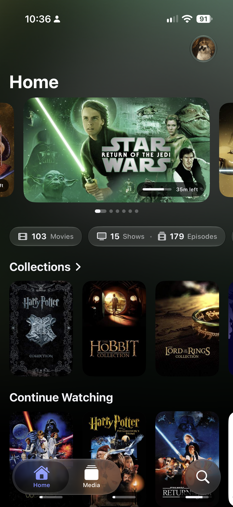
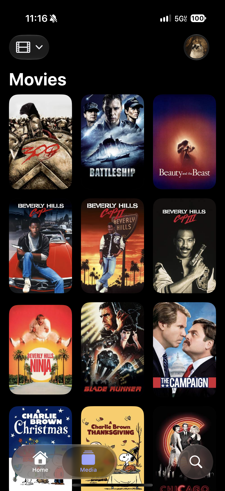
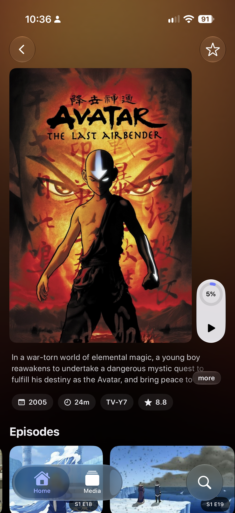
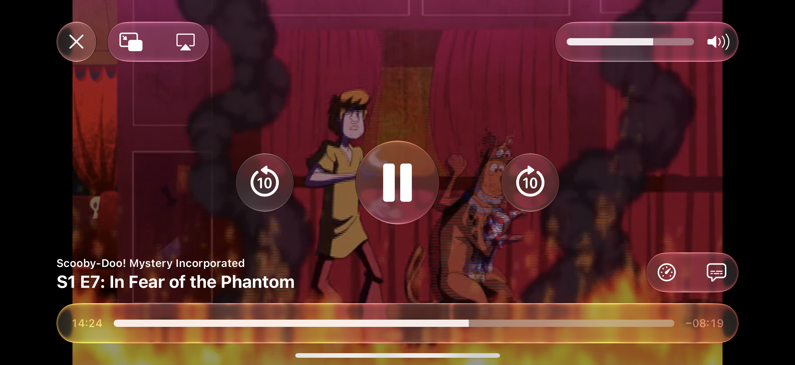
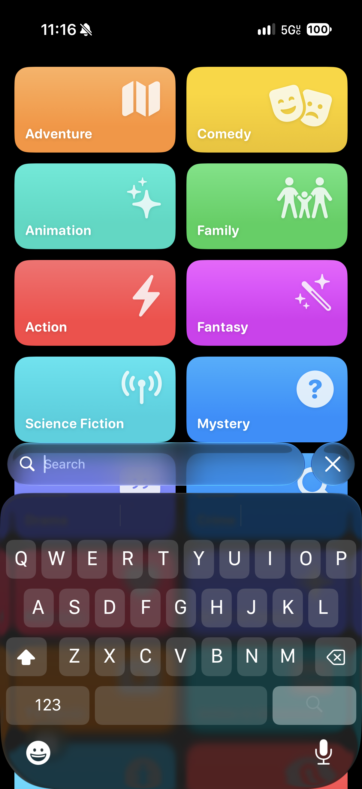
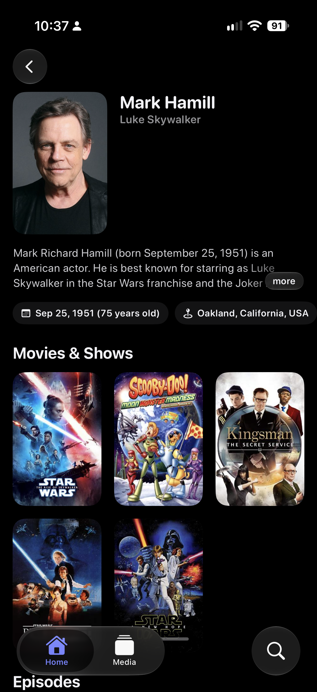
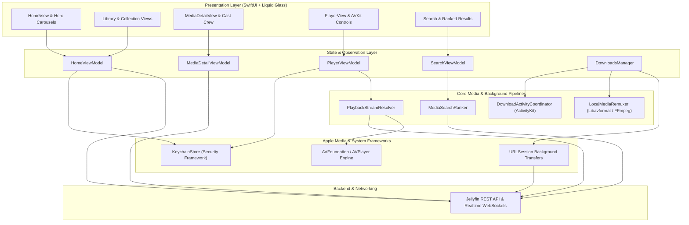

<div align="center">

# JellyBoi

**A sleek, high-performance, native Jellyfin client crafted in SwiftUI for Apple devices.**

[](https://developer.apple.com/)
[](https://swift.org)
[](https://developer.apple.com/swiftui/)
[](https://jellyfin.org)
[](#license--copyright)

</div>

---

## Visual Showcase & Media Pipeline

### Browse & Experience
| Home & Discovery | Media Library | Detailed Media View |
| :---: | :---: | :---: |
|  |  |  |

---

### Player, Search & Deep Metadata
| Native Video Player | Ranked Search | Cast & Crew Credits |
| :---: | :---: | :---: |
|  |  |  |

---

## Overview

**JellyBoi** is a premium, native Apple client engineered specifically for [Jellyfin](https://jellyfin.org) personal media servers. Designed from the ground up utilizing modern **SwiftUI**, Swift Concurrency, and Apple's AVFoundation media pipelines, JellyBoi delivers a deeply integrated streaming and offline experience across iOS, iPadOS, macOS, tvOS, and visionOS.

Equipped with an on-device FFmpeg remuxing engine, background URLSession download pipeline, ActivityKit Live Activities, and a weighted multi-attribute search ranker, JellyBoi provides a blazing fast and visually stunning media experience.

---

## Key Features

### Native Playback Engine
- **Hardware-Accelerated Streaming**: Built on AVFoundation and AVKit with direct streaming and server-driven adaptive HLS fallback.
- **Smart Orientation Management**: Smooth orientation handling and aspect-ratio preservation across all device sizes.
- **Real-Time Playback Synchronization**: Live watch-percentage, resume timestamps, and playback state reporting synced back to the Jellyfin server.
- **On-Screen Audio & Subtitle Control**: Switch audio streams and embedded/external subtitle tracks dynamically with zero playback stall.
- **Diagnostics Overlay**: Real-time bitrates, audio channels, dropped frames, and stream container specs for power users.

### Offline Media Pipeline & On-Device Remuxing
- **Resilient Background Transfers**: Native `URLSessionDownloadTask` background management with auto-resume, battery-conscious queuing, and network handoff.
- **On-Device FFmpeg Remuxing (`LocalMediaRemuxer`)**: Fast, lossless container remuxing (MKV/WebM to MP4) using low-level `Libavformat` and `Libavcodec` on background utility threads to ensure native Apple hardware decoder compatibility.
- **Live Activities & Dynamic Island**: Real-time download progress tracking, percentage meters, and thumbnail previews via ActivityKit.
- **Offline Storage Management**: Dedicated downloads vault with offline playback, storage cleanup, and grouped media browsing.

### Ranked Media Search
- **MediaSearchRanker**: Custom multi-factor scoring engine evaluating title match precision, release recency, popularity, and media kind weighting.
- **Instant Diacritic-Insensitive Search**: Normalized Unicode search across movies, TV series, episodes, collections, and people.
- **Dynamic Filter Pills**: Instant narrowing by media type, genre, played status, and favorite flags.

### Refined Apple-First UI
- **Immersive Hero Carousels**: Dynamic backdrop scaling, blur transitions, and responsive parallax headers.
- **Rich Cast & Crew Views**: Detailed cast profiles, character roles, person bios, and filmography cross-linking.
- **Continuous Watching & Next Up**: Instant single-tap resumption for interrupted cinema and television queues.
- **Liquid Glass Aesthetic**: Glassmorphism styling, native Apple materials, and dynamic theme palette support.

### Security & Multi-Server Management
- **Quick Connect**: Seamless pairing with home servers using one-time verification codes.
- **Keychain Token Security**: Session credentials and auth tokens securely sealed inside the Apple Keychain via `KeychainStore`.
- **Automatic Reconnection**: Resilient websocket and REST session restoration after network switches.

---

## System Architecture



---

## Tech Stack & Dependencies

| Component | Framework / Library | Role |
| :--- | :--- | :--- |
| **Presentation** | `SwiftUI`, `BaseColors`, `Liquid Glass` | Modern declarative UI, materials, and themes |
| **Animation & Headers** | `ScalingHeaderScrollView`, `MarqueeText`, `SkeletonUI` | Fluid parallax scrolling and animated placeholders |
| **State & Concurrency** | Swift Observation (`@Observable`, `@State`), Swift Concurrency | Modern, Combine-free reactive state and async tasks |
| **Media Playback** | `AVKit`, `AVFoundation` | Native hardware-accelerated video decoding |
| **Remuxing Pipeline** | `FFmpegKit`, `Libavformat`, `Libavcodec`, `Libavutil` | On-device container remuxing for Apple compatibility |
| **Networking & API** | `JellyfinAPI`, `Get`, `URLSession` Background Tasks | Type-safe REST communication and background downloads |
| **Live Activities** | `ActivityKit` | Dynamic Island and Lock Screen download progress |
| **Image Pipeline** | `SDWebImageSwiftUI`, `SDWebImage` | Asynchronous image decoding, memory caching, and disk caching |
| **Security** | `KeychainStore` (`Security.framework`) | Encrypted credential and token persistence |
| **Logging & Overlay** | `LoggingKit` (`AppLogger`), `StatusOverlayKit` | Unified structured diagnostics and HUD indicators |

---

## Requirements

- **iOS / iPadOS**: 18.0 or later
- **macOS**: 15.0 or later *(Designed for iPad / Mac Catalyst)*
- **tvOS**: 18.0 or later
- **visionOS**: 1.0 or later
- **Xcode**: 16.0 or later
- **Jellyfin Server**: v10.8.0+ (v10.9+ recommended)

---

## Getting Started

### 1. Clone the Repository

```bash
git clone https://github.com/GarrettButchko/jellyboi.git
cd jellyboi
```

### 2. Open in Xcode

```bash
open JellyBoi.xcodeproj
```

Xcode will automatically resolve all Swift Package dependencies.

### 3. Build & Run

1. Select your target device (e.g., iPhone 16 Pro Simulator or physical iOS device).
2. Choose the **JellyBoi** scheme.
3. Press `Cmd + R` to compile and launch.
4. Input your Jellyfin server address and sign in or use Quick Connect.

---

## GitHub Repository Metadata

Use these values when configuring your GitHub repository settings:

### Description
> Sleek, high-performance native Jellyfin client crafted in SwiftUI for iOS, iPadOS, macOS, tvOS, and visionOS with on-device remuxing, offline downloads, and Live Activities.

### Topics / Tags
```text
jellyfin, jellyfin-client, swift, swiftui, ios, ipados, macos, tvos, visionos, avplayer, avfoundation, ffmpeg, ffmpegkit, remuxing, offline-downloads, live-activities, dynamic-island, media-player, video-streaming, entertainment
```

---

## License & Copyright

**Copyright (c) 2024-present Garrett Butchko. All rights reserved.**

The source code, design assets, and documentation contained in this repository are proprietary and confidential. This repository is source-available solely for portfolio viewing, learning, and architectural evaluation purposes.

No permission is granted to copy, modify, distribute, sublicense, or sell copies of the software, or to launch commercial services derived from this codebase, without explicit prior written authorization from the copyright holder.

For licensing inquiries or commercial use permissions, please contact Garrett Butchko.
